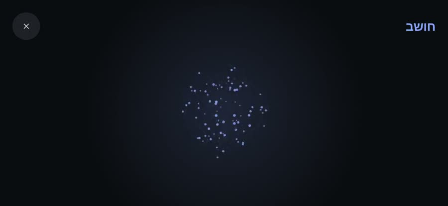
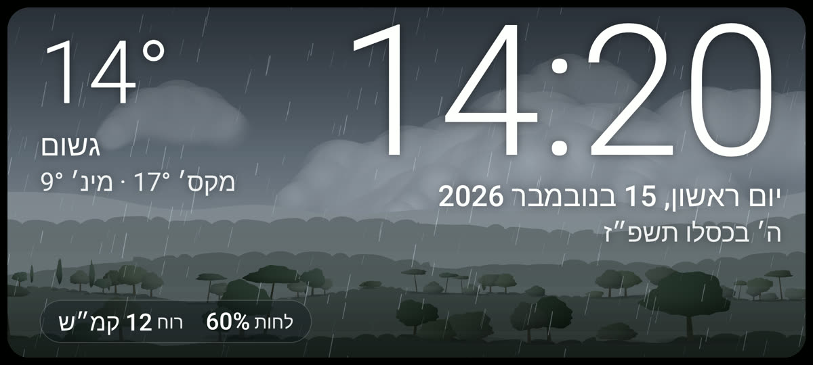
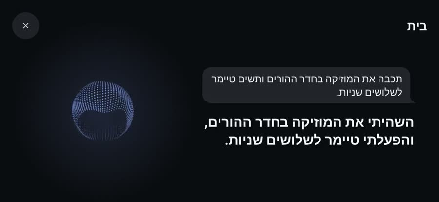

# Bayit Voice

**Turn any spare Android phone or tablet into a voice assistant for your own Home Assistant.**

Bayit Voice listens for a wake word, streams your speech to Home Assistant's Assist, plays the spoken reply, and keeps the conversation going when the assistant asks a follow-up. It can also become a real **Home Assistant voice satellite** with timers, alarms, announcements, and an always-on display, so a phone on a charger replaces a smart display.

It is a generic app: there are no built-in addresses, tokens, languages or device names. Everything comes from your own settings. The UI is in **English and Hebrew** (with full RTL support), and the speech language is whatever your Assist pipeline uses.

> Status: version 0.1.0, a personal project made public. It works well on the devices it was built on (a Realme phone and a few others), but expect rough edges. Issues and pull requests are welcome.

[](docs/media/voice-light.mp4)

*Click the picture to play the video. More videos are listed under [Media](#media).*

---

## Contents

- [What it does](#what-it-does)
- [Install](#install)
- [Quick start](#quick-start)
- [Two ways to connect: Direct and Satellite](#two-ways-to-connect-direct-and-satellite)
- [Conversation screens](#conversation-screens)
- [Wake words](#wake-words)
- [Satellite features](#satellite-features)
- [The idle screen](#the-idle-screen)
- [Several devices in one home](#several-devices-in-one-home)
- [Permissions](#permissions)
- [Privacy and security](#privacy-and-security)
- [Things worth knowing](#things-worth-knowing)
- [Build from source](#build-from-source)
- [Project layout](#project-layout)
- [Media](#media)
- [Thanks and prior work](#thanks-and-prior-work)
- [Licenses and credits](#licenses-and-credits)

---

## What it does

- **Always-on wake word**, running on the device with [openWakeWord](https://github.com/dscripka/openWakeWord) models. A cheap voice-activity gate keeps the heavy models idle in a quiet room, so the background service stays light.
- **Talks to Home Assistant Assist.** It streams audio while you speak, shows what it heard, shows and plays the reply, then closes by itself.
- **Follow-up questions without a wake word.** When the agent asks something back, the app plays a chime and listens again.
- **Works over the lock screen**, and can be set as the phone's digital assistant (side key or long-press home).
- **Your own wake word, in any language.** Train one in a free Colab notebook (a guide is built into the app) and import the `.tflite` file.
- **Voice satellite mode.** HA discovers the device by itself and gets area-aware commands, timers, alarms and reminders, and announcements.
- **Idle screen.** A clock, Gregorian and Hebrew dates, a live animated weather scene, running timers, and a music player for the room. It has a night mode.
- **Several devices at once.** When more than one device hears you, only the nearest one answers.
- **Pause listening** from the notification, a Quick Settings tile, or Home Assistant, which releases the microphone completely.

## Install

1. Download [`releases/bayit-voice-0.1.0.apk`](releases/bayit-voice-0.1.0.apk) to your Android device. It is also in the repository's **Releases** page when one is published.
2. Open it. Android will ask you to allow installing apps from your browser or file manager. This is normal for an app that is not on Google Play.
3. Open **Bayit Voice** and follow the [Quick start](#quick-start).

Requirements: **Android 8.0 (API 26) or newer**, Home Assistant **2025.4 or newer** recommended (earlier versions work, but follow-up questions then need a tap), and a Home Assistant [Assist pipeline](https://www.home-assistant.io/voice_control/) that already works.

The APK is signed with the project's release key. Updates must be signed with the same key, so a build you make yourself cannot be installed over this one without uninstalling it first (which clears the app's settings).

## Quick start

**Fastest path: satellite mode** (best for a device that stays at home)

1. Open the app, choose **Satellite** as the connection mode, and grant the microphone permission.
2. In Home Assistant, go to **Settings → Devices & services**. The device should appear as a discovered ESPHome device. Add it and enter the encryption key shown in the app. If it does not appear, add an ESPHome device by hand with the `IP:6053` shown in the app.
3. On the device's page in Home Assistant, choose its **area**, its **assistant** (pipeline) and its **wake word**.
4. Say the wake word.

**Direct mode** (best for your own phone, including away from home)

1. Open the app and choose **Direct**.
2. Enter your Home Assistant address. You can set a *home* address (used on your home network) and an *external* address (used elsewhere). The app picks the right one by itself.
3. Create a **long-lived access token** in Home Assistant (your profile → **Security** → **Long-lived access tokens**) and paste it into the app.
4. Press **Test connection**, then pick a pipeline. The first choice, **Default**, follows whichever pipeline Home Assistant prefers.
5. Turn on the wake word, or just tap the microphone button.

## Two ways to connect: Direct and Satellite

The two modes have different purposes, and each feature belongs to one of them.

| | **Direct** | **Satellite** |
|---|---|---|
| Think of it as | A personal assistant on your phone, instead of "Hey Google" or Siri | A fixed home device, instead of a Nest Hub |
| How it connects | The app is a WebSocket client of Home Assistant (`assist_pipeline/run`) | The app is an **ESPHome device** that Home Assistant connects to (encrypted with Noise) |
| Needs | HA address and a token | Only that HA can reach the device on the local network |
| Works away from home | Yes (with an external address) | No |
| Timers, announcements, "turn off the light here" | No | Yes |
| Idle screen | No | Yes |
| Who picks the pipeline, area and wake word | The app | Home Assistant |

You can switch modes at any time. Each mode keeps its own settings.

## Conversation screens

In direct mode you pick a style per device. Satellite mode always uses Full screen.

- **Wave** (default): a dark sheet that slides up over whatever is on screen, with the words, the reply and a waveform that follows the reply's loudness.
- **Futuristic**: the same sheet with an animated orb of dots. Each state has its own orb: connecting, listening (reacts to your voice), thinking, speaking.
- **Full screen**: for a device on a wall or a shelf. A large orb, large type, readable across the room, in both orientations.

| Wave and Futuristic, then Full screen |
|---|
| [](docs/media/session-demo.mp4) |

Hebrew niqqud (vowel points, often added to steer text-to-speech) is hidden in the shown reply but kept in the spoken audio.

## Wake words

- **Built in:** *Hey Bayit* (Hebrew, "היי בית", the default), plus the openWakeWord models *Alexa*, *Hey Jarvis*, *Hey Mycroft* and *Hey Rhasspy*.
- **Import your own** `.tflite` openWakeWord model from the settings. You can rename or delete imported models.
- **Train your own.** *Settings → Wake word → Train your own* explains the steps. The training pipeline is in [`tools/wake_word_training`](tools/wake_word_training/README.md). It runs on a free Colab GPU in about two hours and uses synthetic speech only, so it needs no recordings.
- **Sensitivity** is adjustable, and there is a cooldown after each detection.

## Satellite features

- **Timers** from Home Assistant ("set a timer for ten minutes", "how much time is left", "cancel the timer"). They run on the device itself, so a dropped connection does not delay the ring. A small chip shows the next timer, and a full ringing screen opens over the lock screen. Stop it by touch or by saying the wake word.
- **Alarms and reminders** at a time of day, stored on the device. Alarms offer *Stop* and *Snooze*; reminders show their text with *Done* and *Remind me in 10 minutes*. They are exposed to Home Assistant as actions (`set_alarm`, `set_reminder`, `list_alarms`, `cancel_alarm`) that your own scripts and the assistant can call. See [SPEC.md section 10.1](SPEC.md) for the details.
- **Announcements** (`assist_satellite.announce`) with a pre-announce sound, and *start conversation*, where the device asks a question and then listens.
- **Area awareness**: commands such as "turn off the light here" act on the device's area.
- **A "Wake word listening" switch** appears in Home Assistant, so an automation can mute the microphone, for example on Shabbat or at night, and turn it back on later.
- **Several wake words**: the device reports its installed models and Home Assistant chooses which one is active.

## The idle screen

A device that stays home shows its own display on the charger, so it needs no separate clock or screen-saver app (satellite mode only).

- A very large clock in the system's 12 or 24-hour format, the Gregorian date, and the **Hebrew date** (computed offline).
- A **weather scene drawn in code**, with no bundled images. It follows the real condition and time of day: clear, cloudy, rain, thunder, fog, snow, sunrise and sunset (from `sun.sun`), and a starry night.
- Temperature, condition, today's high and low, humidity and wind.
- The **next running timer** in a large chip.
- A **music player** for the room's media player: artwork, title, artist, progress, previous/play/next, and a volume slider. The layout changes while music plays.
- **Night mode**: between hours you choose, only a dim red clock shows, or the screen turns off. Content shifts a few pixels each minute to avoid burn-in.
- It opens as the system **screen saver** where Android has one, and through *Open automatically while charging* on phones that remove it (Realme, Oppo and others).

| Rain | Sunrise | Sunset |
|---|---|---|
|  |  |  |

You choose the weather entity and the media player in the settings. Nothing is hard-coded. For the forecast and the music controls, turn on **Allow the device to perform Home Assistant actions** on the device's page in Home Assistant. Without it, the high/low and the music controls are hidden and everything else still works.

## Several devices in one home

If several devices running the app hear the same wake word, **only the nearest one answers**. All of them react at first so you can keep talking, then the others step aside and show "Answering on: *device name*". It works by sending small signed messages over UDP multicast on the local network, with no server and no extra Home Assistant setup. In direct mode, a satellite wins ties against a phone unless the phone heard you at least 10 dB better, so a phone in a pocket does not take a timer command that only the satellite can carry out. If multicast is blocked on your network, each device simply answers on its own.

## Permissions

| Permission | Why |
|---|---|
| Microphone | Wake word and speech |
| Notifications | The always-on listening notification, and a way to pause |
| Display over other apps | To open the conversation, timers and the idle screen from the background (Android blocks background activity starts otherwise) |
| Local network (Android 17+) | To reach a Home Assistant address on your home network |
| Location | *Optional.* Only to read the current Wi-Fi name, when you add your home networks. |
| Run at startup, ignore battery optimization | So listening survives a reboot and is not killed |
| Full-screen notifications | A fallback when "Display over other apps" is not granted |
| Alarm clock | In direct mode, to set alarms in the phone's clock app |

## Privacy and security

- The app talks only to **your** Home Assistant (and, in direct mode, to the external address you enter). It has no analytics, no ads, no accounts and no cloud service of its own.
- Your token and the satellite encryption key are kept encrypted with a key held in the **Android Keystore**, and are never logged.
- Plain `http://` is allowed only for private and local addresses, with a warning in the settings.
- Backups of the app's data are turned off.
- Wake-word detection runs entirely **on the device**. Audio leaves it only after a wake word (or a tap), going to your Home Assistant.

## Things worth knowing

- **Android lets one app record at a time.** While Bayit Voice listens for the wake word, apps like a voice recorder may refuse to record. Use the *Pause* button in the notification (or the Quick Settings tile) to release the microphone.
- **Phones kill background apps.** Exclude the app from battery optimization, and on some brands (Xiaomi, Oppo/Realme, Samsung) also allow auto-start and background activity.
- **Satellite mode needs the device reachable on the local network** from Home Assistant. Guest networks and "client isolation" will block it. Direct mode has no such limit.
- **Follow-up questions** depend on the conversation agent. Home Assistant marks a reply as a question only when the agent's answer ends with one.
- **Wake word accuracy** depends on the model. The bundled *Hey Bayit* was trained on synthetic and recorded Hebrew speech. Raise or lower the sensitivity if it triggers too often or too rarely.
- The idle screen costs about 25% of one CPU core while visible (about 3% of a modern 8-core phone), against about 1% for the listening service alone.

## Build from source

You need Android Studio (or JDK 17 and the Android SDK, with SDK platform 37).

```bash
./gradlew assembleDebug          # debug build: app/build/outputs/apk/debug
./gradlew testDebugUnitTest      # unit tests
./gradlew assembleRelease        # release build (see below)
```

The debug build adds a few developer tools (a fake wake-word trigger and a demo screen) that are not in the release build.

**Signing a release.** Create your own keystore, then put its details in an untracked `keystore.properties` in the project root:

```properties
storeFile=C:/path/to/your-release.jks
storePassword=...
keyAlias=...
keyPassword=...
```

Without that file, `assembleRelease` produces an unsigned APK. Never commit the keystore or `keystore.properties`; both are git-ignored.

The application id lives in one place, `gradle.properties` (`bayitvoice.applicationId`). If you fork the app, change it there.

## Project layout

| Path | What |
|---|---|
| `app/` | The Android app (Kotlin, Jetpack Compose, minSdk 26) |
| `app/src/main/java/.../wakeword` | openWakeWord pipeline on LiteRT, voice-activity gate |
| `app/src/main/java/.../satellite` | ESPHome API server, Noise encryption, protobuf messages, mDNS |
| `app/src/main/java/.../ha` | Home Assistant WebSocket client and server selection |
| `app/src/main/java/.../session` | One conversation turn, from audio to reply |
| `app/src/main/java/.../arbitration` | Nearest-device arbitration over UDP multicast |
| `app/src/main/java/.../ui` | Conversation screens, settings, orb, timer and idle screens |
| `tools/` | Wake-word training pipeline, and a test peer for multi-device arbitration |
| `docs/` | Design mock-ups (open in a browser) and research notes |
| `SPEC.md` | The full specification, with every design decision |

## Media

| | |
|---|---|
| [](docs/media/voice-light.mp4) | **Voice command.** Wake word, listening, thinking, reply with a check mark, and "Speak again". |
| [](docs/media/voice-music-timer.mp4) | **Music and a timer.** Starting music in the room and a timer by voice; the idle screen shows the player and the timer; the timer rings. |
| [](docs/media/voice-music-reminder.mp4) | **Music and a reminder.** A voice-set reminder with the music player on the idle screen. |
| [](docs/media/session-demo.mp4) | **Session over the idle screen.** The conversation opens over the weather screen and returns to it. |

Live, animated design mock-ups are in [`docs/`](docs): [idle screen](docs/idle-screen-demo.html), [alarm and timer screens](docs/alert-screens-demo.html) and [orbs](docs/orbs-demo.html). Download the repository and open them in a browser.

## Thanks and prior work

Bayit Voice stands on the shoulders of other open-source projects. Thank you to their authors.

- **[Ava](https://github.com/brownard/Ava)** by brownard (Apache 2.0): an Android voice assistant that speaks the ESPHome protocol. It showed that an Android phone can be a Home Assistant satellite, and we studied it as a reference for message order and Home Assistant quirks. The code in this repository was written separately.
- **[openWakeWord](https://github.com/dscripka/openWakeWord)** by David Scripka: the wake-word models and the detection pipeline, and the base of our training notebook.
- **[Piper sample generator](https://github.com/rhasspy/piper-sample-generator)** (Rhasspy / Open Home Foundation): the synthetic speech used to train wake words.
- **[Linux Voice Assistant](https://github.com/OHF-Voice/linux-voice-assistant)** and **[Wyoming](https://github.com/OHF-Voice/wyoming)** (Open Home Foundation): the reference for how a modern Home Assistant satellite behaves, and the reason we chose the ESPHome protocol.
- **[aioesphomeapi](https://github.com/esphome/aioesphomeapi)** and **[ESPHome](https://esphome.io)**: the native API definition (`api.proto`) that our satellite implements.
- **[thinking-orbs](https://github.com/Jakubantalik/Libraries.dev)** by Jakub Antalik: the animated orb geometry.
- **[Home Assistant](https://www.home-assistant.io)**, **[Music Assistant](https://music-assistant.io)** and the **[Noise Protocol Framework](https://noiseprotocol.org)**, which this app is built around or uses.

## Licenses and credits

- **The built-in wake-word models** and the openWakeWord feature models (melspectrogram, embedding) are by David Scripka ([openWakeWord](https://github.com/dscripka/openWakeWord)) and are licensed under **CC BY-NC-SA 4.0**. They **may not be used commercially**. The *Hey Bayit* model is trained on the same openWakeWord data, so the same terms apply to it. The openWakeWord code is Apache 2.0.
- The animated orbs are based on [thinking-orbs](https://github.com/Jakubantalik/Libraries.dev) by Jakub Antalik (MIT).
- The ESPHome native API messages come from [aioesphomeapi](https://github.com/esphome/aioesphomeapi) (MIT).
- Libraries: LiteRT (TensorFlow Lite), OkHttp, AndroidX, Jetpack Compose, Kotlin coroutines (Apache 2.0) and BouncyCastle (MIT).
- Home Assistant and ESPHome are trademarks of their owners. This project is not affiliated with them.

**The app's own source code** is licensed under the [Apache License 2.0](LICENSE). The bundled wake-word models are not covered by it: they keep their own CC BY-NC-SA 4.0 terms (non-commercial), as described above. If you use the app commercially, remove or replace the bundled models and use models you are allowed to use that way.
